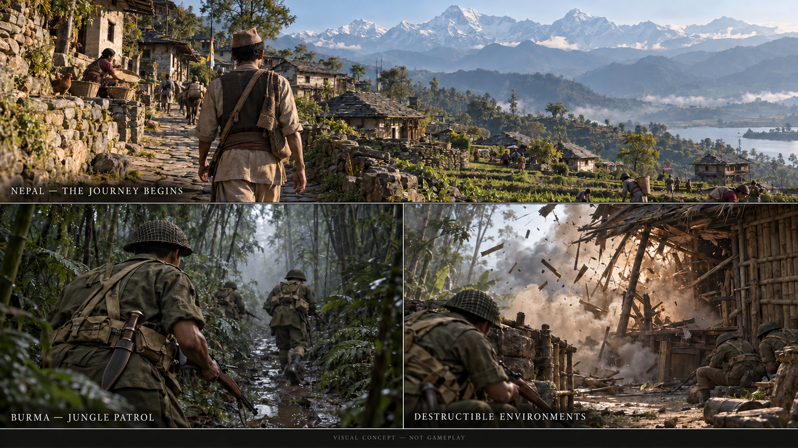

# GURKHA: The Long Way Home

Story and technical specification — concept draft, 11 October 2026

## Creative direction

A single-player historical war game about a fictional young Nepali man becoming a Gurkha soldier in the British Indian Army during the Second World War. His journey begins in the Himalayan foothills and leads to the Burma campaign. The aim is to let the player experience his home, friendships, training, uncertainty and responsibility for fellow soldiers.

The story is loosely inspired by real Gurkha experiences, including Lachhiman Gurung VC’s defence at Taungdaw on 12–13 May 1945. It is historical fiction, not a biography or a claim that our invented missions happened to him. The fictional protagonist is not awarded Lachhiman’s real medal or credited with his exact achievements.

Working title: GURKHA: The Long Way Home. First prototype mission: Until Dawn. Titles remain provisional.

## Characters

- **Bir Bahadur Gurung:** fictional young man from a fictional village in the hills near Pokhara. Capable outdoors, inexperienced in war, motivated by family responsibilities and curiosity about life beyond the village. His age and enlistment date remain provisional until the campaign chronology is selected.
- **Dhan:** fictional childhood friend and fellow recruit. His humour creates familiarity and companionship; his survival should not be treated as an automatic plot twist.
- **Havildar Kesar:** fictional experienced Gurkha section leader. He teaches patience, fieldcraft and responsibility through practical corrections.
- **Family:** Bir’s parents and younger sister. Their circumstances and dialogue will be developed with cultural research rather than presented as universal Nepali experiences.

## Storyline

### 1. The Mountain Path — Nepal

An ordinary morning introduces Bir’s village. He carries supplies along a stone path, works on the terraces and helps his family. The player learns movement, interaction and the practical use of a kukri through everyday tasks.

Dhan plans to enlist. Bir chooses to accompany him, hoping to support his family. A quiet farewell and the walk down the hillside establish what leaving costs him. The village is a place the player knows, not merely a cinematic backdrop.

### 2. Becoming a Rifleman — British India

Recruitment and training introduce new routines and friendships. Bir struggles with unfamiliar commands, learns weapon handling and gradually becomes reliable within his section. Drill, fieldcraft, navigation and first aid become playable lessons.

Between exercises, recruits share meals, joke in Nepali and write home. Kesar’s mentorship links these quieter moments to the responsibility they will carry in the field. Exact recruiting routes, depots, uniforms and terminology require period research.

### 3. The Green Silence — Burma

Bir enters a jungle environment that feels enclosed and difficult to read. Rain masks footsteps, mud slows movement and the section relies on voices and gestures to stay together.

A patrol develops into a short encounter. The player must regain contact with comrades, help a wounded man and withdraw as a group. The evening ends with Bir trying to describe his experience in a letter without alarming his family.

This is a proposed fictional mission; its date and location will be fitted to a researched unit’s movements.

### 4. Brothers in the Rain — campaign missions

Several compact missions deepen relationships: escorting supplies, crossing a river, finding a separated patrol and preparing a defensive position. Civilian encounters show that the landscape is inhabited and affected by the fighting.

Bir becomes someone new recruits rely on. Optional conversations and small acts of assistance develop this change. Outcomes can alter later dialogue, available supplies and comrades’ condition, without rewriting major historical events.

### 5. Until Dawn — the isolated position

The section occupies a small forward position overlooking a jungle approach. The player first walks the perimeter, learns the sightlines, prepares cover and shares the watch with familiar comrades.

A night attack cuts communication and damages parts of the position. Bir moves between threatened posts, helps the wounded and manages limited ammunition. His objective is to keep the approach defended until help arrives.

The emotional inspiration is Lachhiman Gurung’s documented determination to protect his position and comrades. Our encounter, dialogue and timings are fictional. If we later choose to reproduce his actual action, it requires a separately researched adaptation, including the injuries, rifle handling and witness accounts.

Night passes through short playable phases and quiet intervals. Dawn reveals the surviving section and the cost of the defence. Combat victory is followed by care for the wounded and relief, rather than a score celebration.

### 6. The Long Way Home — epilogue

Bir returns to the mountain path introduced at the beginning. Familiar places are unchanged in some ways, while his relationships and perspective have changed. A conversation with his family closes the personal story.

An optional historical epilogue acknowledges the real Gurkha soldiers and explains which events inspired the fiction. Archival images or recordings would require appropriate usage rights.

## Immersion and presentation

First-person is the recommended gameplay perspective, pending the user’s final choice. Occasional third-person scenes can establish departure, conversation and return. The previous concept images illustrated atmosphere in third-person; they do not lock the camera choice.

Use natural Nepali dialogue among Gurkhas, with subtitles and researched English commands where appropriate. Prioritise footsteps, breathing, rain, jungle ambience and recognisable comrades’ voices. Keep the HUD restrained, with optional objective guidance and accessibility settings.

Physical realism should support readable, comfortable gameplay: deliberate reloading, wet surfaces, believable movement and wounds affecting capability. Avoid excessive waiting or cumbersome controls. The kukri must have a recognisable forward-curving blade, correct scabbard and researched period carrying position. Do not turn every encounter into an invented kukri charge.

## Visual direction — approved concept art

The user selected the generated three-panel concept board as the reference for the game's look. Use the revised version with the kukri at the foreground soldier's rear belt. The original version's generic straight knife is superseded.

Reference image: corrected concept board generated on 11 October 2026. The embedded image points to the existing concept image; the written visual brief below also stands on its own if that image is unavailable in another editor.

### Scene 1 — Nepal: The Journey Begins

A wide view follows a young Nepali man from behind as he walks a stone path through a hillside village. Stone walls, timber details, slate-roofed houses, baskets and small everyday activities establish a lived-in home. Terraced fields lead towards a valley, with snowy Himalayan peaks in the distance. Warm morning sunlight and atmospheric haze create depth and a calm, welcoming mood.

Carry into the game: human-scale paths, layered mountain silhouettes, believable rural materials, subtle village activity and a sense of belonging. The panorama is an artistic composition; research the eventual village geography, clothing and period architecture before reproducing individual details.

### Scene 2 — Burma: Jungle Patrol

An over-the-shoulder view places the player close behind a Gurkha rifleman moving with his comrades along a muddy trail. Tall trunks, bamboo, ferns and dense foliage narrow the view. Cool, muted greens, humid mist, wet leaves, worn fabric and muddy equipment make the jungle feel close and physically demanding.

The soldier carries a rifle, period-style webbing, a steel helmet and a traditional kukri in a curved dark scabbard at his rear belt. The corrected kukri silhouette, wooden handle and practical scale are essential reference details. Verify the finished weapon, uniform and carrying arrangement against period sources.

Carry into the game: limited sightlines, recognisable squad silhouettes, layered foliage, wet surfaces and restrained lighting. Preserve this mood when simplifying decorative vegetation for the M1; density in a concept painting is not an asset-count requirement.

### Scene 3 — Destructible Environments

Soldiers take cover near a bamboo-and-timber hut as part of its structure breaks apart. Exposed beams, splintered wood and a cloud of dust show the physical effect of the impact. Light filtering through the damaged roof makes the changing structure readable. The visual focus is timber, debris and vulnerable cover rather than an oversized fireball.

Carry into the game: selected breakable huts, fences and props, believable material response, clear damage states and sound that supports the collapse. Prepare intact and fractured assets deliberately. Gameplay-critical changes to cover must work on every graphics preset; cosmetic dust and debris can scale.

### Shared art requirements

- Aim for grounded, photorealistic materials: weathered stone and timber in Nepal; mud, wet foliage, cloth, leather and worn metal in Burma.
- Use warm, open village lighting and cooler, enclosed jungle lighting to establish the journey's changing atmosphere.
- Maintain natural proportions and believable equipment weight. Avoid oversized weapons, pristine uniforms and superhero posing.
- Give the kukri its distinctive forward curve and matching sheath. Do not accept a straight dagger or machete as a substitute.
- Match assets across sources through scale, material roughness, wear and colour grading. Tripo output needs review and refinement to fit this direction.
- Preserve the scenery, materials and atmosphere in first-person gameplay if that perspective is selected. The concept board's third-person framing remains useful for cinematics and character inspection.
- Use the captions as descriptions of the concepts, not as a requirement to place large labels over gameplay. Keep in-game interfaces restrained.

The board is the approved artistic direction, not an actual screenshot or verified performance target. The high-end version should pursue its visual richness; the M1 version should preserve its composition, atmosphere and material consistency within a measured performance budget.

## Technical specification

| Area | Proposed specification |
|---|---|
| Engine | Unreal Engine 5.8 (current on 11 October 2026). Epic recommends Xcode 26.1.1, which is installed; minimum Xcode 26.0. Xcode 26.4 is listed as incompatible, so hold Xcode updates. Editor needs macOS 14.5 or later |
| Development hardware | MacBook Pro with Apple M1 Pro (16-core GPU), 16 GB unified memory, macOS 15.7, Xcode 26.1 (checked 11 October 2026) |
| Initial platform | macOS on Apple Silicon. Minimum player spec: base M1 with 8 GB unified memory. Minimum OS version set by the selected engine |
| Subsequent platform | Windows, using separate builds and testing on actual Windows hardware |
| Structure | Single-player, offline campaign; no multiplayer or account system in the first scope |
| Gameplay code | Blueprint for rapid iteration; C++ where justified by complexity or performance |
| Models | Tripo-generated starting assets, refined and checked in Blender |
| Asset workflow | Generate, inspect, correct scale/materials, optimise, create collision, import and test |
| Characters | Rigging, compatible skeletons, animation and retargeting need explicit setup and validation |
| Rendering | Built for the M1 8 GB minimum: baked lighting, conventional mesh LODs, no Nanite. Lumen off by default; at most an optional High/Ultra setting |
| Destruction | Selected structures and props using Chaos; prepared geometry, constraints and collision |
| Audio | Licensed or original ambience, effects and dialogue; subtitles and independent volume controls |
| Controls | Keyboard and mouse initially; controller support after the core controls work |
| Saving | Local settings and checkpoint saves |
| Version control | Git for code; an appropriate large-file workflow for binary assets |

Unreal’s current Mac documentation lists 16 GB as minimum memory and recommends 32 GB or more. These are editor requirements for development, not requirements for players. Nanite support is listed for M2 and newer Macs, so it is not used. Lumen is expensive on the base M1 GPU, so the game is lit with baked lighting and a few dynamic lights (flares, muzzle flashes).

The minimum player spec is a base M1 MacBook with 8 GB of unified memory. On Apple Silicon this memory is shared by macOS, the game and the GPU, so the packaged game must stay within roughly 4 to 5 GB in total (unverified estimate). The development Mac is an M1 Pro with about twice the GPU cores of a base M1, so it cannot stand in for the minimum spec. Test on a base M1 8 GB machine, borrowed or second-hand, before each milestone.

### Performance and graphics settings

Initial benchmark goal: a small scene at approximately 1080p output and 30 fps on a base M1 with 8 GB, on the Low preset, with render scale or upscaling as needed. This is an unverified target, not a guaranteed result. Profile packaged builds, including the most demanding combat and destruction moments.

| Preset | Proposed visual adjustments |
|---|---|
| Low | Minimum spec (base M1, 8 GB). Reduced decorative foliage, shadow quality, effects and texture memory demand |
| Medium | Balanced scenery, lighting and effects; tune on the development M1 Pro |
| High | Denser decorative scenery, improved lighting and higher texture/shadow quality |
| Ultra | Highest supported visual settings, validated on stronger hardware |

Resolution is separate from the quality preset. Offer 1080p, 1440p and 4K where supported by the display, with render-scale/upscaling options when suitable. 4K output and native 4K rendering are distinct; native 4K on the M1 is not the starting performance goal.

Maintain gameplay-critical cover, collisions and structural destruction across presets. Scale dust, decorative debris and other cosmetic effects. Settings alone cannot compensate for an oversized scene: asset budgets, foliage, AI, animation and physics all need profiling.

### Costs and tools

Unreal is free to begin game development, with full features. Under its standard game licence, royalties generally apply above US$1 million in lifetime gross product revenue; the current licence governs the actual obligations. Blender is free. Tripo API generation uses paid credits separately from Studio subscriptions.

The prototype can use free starter content, simple meshes made in Blender and appropriately licensed free assets. Tripo use is optional during the first build. Paying Tripo does not provide automatic gameplay, historical accuracy, finished animation or an Unreal project.

Generate assets during development and ship the resulting files. Keep API credentials in local development configuration and out of source control and distributed builds. The offline game does not need to call Tripo while players play.

The AI assistant can help prepare code, scripts, Blueprint logic, asset specifications and debugging. Local Unreal editor operation, compilation and performance testing require access to the user’s Mac or user-run checks; this conversation does not currently provide direct access to that editor.

## First playable milestone

Build a compact 10–15-minute version of Until Dawn:

1. One jungle approach, a defensive position and one small destructible structure.
2. First-person movement and interaction; placeholder character assets.
3. One rifle with aiming, firing and reloading.
4. Two nearby comrades with limited scripted behaviour.
5. A short preparation phase, one controlled attack and a relief ending.
6. Basic sound, subtitles, checkpoint and Low/Medium settings.
7. A packaged Mac build profiled on a base M1 with 8 GB, followed by a Windows compatibility check when hardware is available.

Defer the full village, complete recruitment sequence, long campaign, advanced squad AI, large-scale destruction and Ultra/4K validation until this milestone works. The prototype proves atmosphere and gameplay before production assets are purchased or generated in quantity.

## Decisions still open

- Confirm first-person gameplay versus third-person or a hybrid.
- Select the fictional unit affiliation and campaign chronology from historical research.
- Find a base M1 8 GB Mac for minimum-spec testing.
- Free up disk space before installation: about 151 GB was available on 11 October 2026.
- Choose engine version and verify Tripo plugin compatibility; offline asset import remains a fallback.
- Set a Tripo spending limit, with zero additional spending as the default prototype approach.

## Sources and verification

Historical anchor: the Burma Star Memorial Fund reproduces Lachhiman Gurung’s VC recommendation and witness statements. They describe his defence on 12–13 May 1945, continued rifle fire after severe wounds, and the position remaining cut off until relief. None of our fictional missions should be attributed to him as fact.

- [Lachhiman Gurung VC recommendation and witnesses](https://burmastarmemorial.org/vc-havildar-lachhiman-gurung)
- [Unreal Engine licensing](https://www.unrealengine.com/license)
- [Unreal macOS requirements](https://dev.epicgames.com/documentation/en-us/unreal-engine/macos-development-requirements-for-unreal-engine)
- [Unreal scalability](https://dev.epicgames.com/documentation/en-us/unreal-engine/scalability-reference-for-unreal-engine)
- [Chaos destruction overview](https://dev.epicgames.com/documentation/unreal-engine/destruction-overview?lang=en-US)
- [Tripo plugins and integration](https://developers.tripo3d.ai/en/docs/plugins)
- [Tripo Studio and API billing distinction](https://www.tripo3d.ai/help/api-plugins/tripo-studiotripo-api)
- [Blender licence](https://www.blender.org/about/license/)

These specifications are proposals derived from the discussion, not tested implementation results. Engine requirements, integrations and commercial terms should be rechecked at setup and release.
